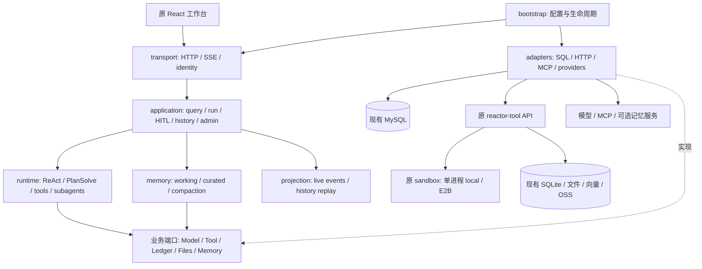

# Python 目标架构与关键取舍

> 2026-10-04 P5 当前检查点：交付/图片/全部管理接口已实现，159 确定性通过、46 真实隔离集成与 Java 5+2+11 帧回放通过；管理员登录、原工作台交互和中文导出视觉通过，P5完成后停止。原 UI 434 通过/2 个已知基线失败保留。真实图片/模型供应商与真实旧数据仍 U。已批准访客 theme/template 独立配置、共享只读；见 [P5报告](p5-report.md)。完成 P5 后停止，不启动 P6。

> 2026-10-04 当前检查点：P4 实现及隔离验收完成，停止。用户已批准访客 Skill 会话副本/管理员共享库方案；141 确定性测试通过（1 环境门控 skip）、50 真实隔离集成、70 原 Java 记忆测试通过。macOS 原生文件边界已验证，外部记忆 provider/MCP/E2B 与真实旧数据仍 U；管理 HTTP 留 P5。见 [P4报告](p4-report.md) 和 [progress.md](progress.md)。下文历史“未启动/待确认”以本条为准。

> 2026-10-03 P3收尾更新：用户已授权独立SQLite替代H2业务源及可信身份/持久owner/内部认证方案。下文原审计的待确认记录为历史；最新实现、验收与边界见 [P3收尾报告](p3-closure-report.md)。Reactor MySQL账本及Tool SQLite保持，Java/H2保留回滚；P4未启动。

2026-10-02，架构已获确认；本轮准备/P0完成，Python业务尚未实施。范围按 [inventory.md](inventory.md) F01–F42；确定性行为按 [contracts.md](contracts.md)。

## 1. 服务边界：保留独立 Agent、Tool API、Sandbox 进程

建议新增 `reactor-backend/` Python 包（例如 `reactor_backend`），替代当前 Java backend 的运行职责，继续使用 8100 和现有代理路径；原 Maven 模块完整保留。`reactor-tool` 的检索、RAG、CodeAct、文件服务、SOP、docgen/docread/dataprep 保持实现并由 HTTP/SSE 调用。继续保留 api:1601 与单 worker sandbox:1602 两个角色；本地 all 模式只作原兼容入口。

此决定来自 [docker-compose.yml:1](../../docker-compose.yml#L1)、[__init__.py:14](../../reactor-tool/reactor_tool/api/__init__.py#L14)、[service_role.py:14](../../reactor-tool/reactor_tool/service_role.py#L14)、[server.py:88](../../reactor-tool/server.py#L88)：工具服务已经有有状态 Python 子进程/E2B 管理，且依赖 OCR、文档、向量和数据分析的大量组件。将它们合并进 Agent HTTP 进程会混合依赖、资源预算、生命周期与并发 worker 规则。统一语言没有消除隔离需要。

代价是保留一次内部 HTTP/SSE 边界、超时与取消配合，以及文件/账本跨存储一致性；复用现有接口和共享 volume 能限制迁移风险。不会新建与原检索/分析并行的另一套实现。也不将当前 Java 直连的图片网关误认成已存在的 Python 工具（[ReactorImageGenerationGateway.java:29](../../Reactor-agent-infrastructure/src/main/java/org/wwz/ai/infrastructure/gateway/ReactorImageGenerationGateway.java#L29)），它迁入 backend 的供应商 adapter。

## 2. 模块和依赖方向

建议目录按实际职责，不按 Maven 模块一一对应：

| 模块 | 负责的规则/端口 | 迁移依据 |
| --- | --- | --- |
| `transport` | 旧方法/路径/DTO alias、Cookie/CORS、multipart/binary、SSE 帧，异常转译 | [AiAgentController.java:31](../../Reactor-agent-trigger/src/main/java/org/wwz/ai/trigger/http/AiAgentController.java#L31)、[AgentRunController.java:46](../../Reactor-agent-trigger/src/main/java/org/wwz/ai/trigger/http/agent/AgentRunController.java#L46)、[BaseFilterConfig.java:26](../../Reactor-agent-trigger/src/main/java/org/wwz/ai/trigger/config/BaseFilterConfig.java#L26) |
| `application` | query 准入、会话归属、Run control、HITL continuation、history、featured/admin、data_query | [GptQueryApplicationService.java:37](../../Reactor-agent-case/src/main/java/org/wwz/ai/application/agent/query/GptQueryApplicationService.java#L37)、[ConversationSessionOwnershipApplicationService.java:22](../../Reactor-agent-case/src/main/java/org/wwz/ai/application/agent/visitor/ConversationSessionOwnershipApplicationService.java#L22) |
| `runtime` | Agent 状态与步边界、工具循环/并行结果顺序、取消、准入/资源预算、子 Agent/mailbox/Todo | [BaseAgent.java:57](../../Reactor-agent-domain/src/main/java/org/wwz/ai/domain/agent/runtime/agent/BaseAgent.java#L57)、[ToolExecutionPipeline.java:1](../../Reactor-agent-domain/src/main/java/org/wwz/ai/domain/agent/runtime/agent/ToolExecutionPipeline.java#L1)、[ActiveAgentRunRegistry.java:26](../../Reactor-agent-domain/src/main/java/org/wwz/ai/domain/agent/runtime/cancel/ActiveAgentRunRegistry.java#L26) |
| `models` | 内部 message/tool-call/usage、模型调用策略与目录规则；供应商 DTO 留在 adapter | [LLM.java:55](../../Reactor-agent-domain/src/main/java/org/wwz/ai/domain/agent/runtime/llm/LLM.java#L55)、[LlmModelCatalog.java:26](../../Reactor-agent-domain/src/main/java/org/wwz/ai/domain/agent/runtime/llm/LlmModelCatalog.java#L26)、[LlmRequestRetry.java:29](../../Reactor-agent-domain/src/main/java/org/wwz/ai/domain/agent/runtime/llm/LlmRequestRetry.java#L29) |
| `projection` | 统一 canonical eventData、实时聚合、follow buffer、账本历史 replay；运行事实与视图分离 | [BaseAgentResponseHandler.java:29](../../Reactor-agent-domain/src/main/java/org/wwz/ai/domain/agent/runtime/handler/BaseAgentResponseHandler.java#L29)、[ConversationHistoryReplayService.java:29](../../Reactor-agent-domain/src/main/java/org/wwz/ai/domain/agent/ledger/replay/ConversationHistoryReplayService.java#L29) |
| `memory` | working memory/tool-pair protocol、预算压缩、curated scope、flush/review fork、session_search | [WorkingMemoryCompactor.java:20](../../Reactor-agent-domain/src/main/java/org/wwz/ai/domain/agent/memory/WorkingMemoryCompactor.java#L20)、[LtmManager.java:22](../../Reactor-agent-domain/src/main/java/org/wwz/ai/domain/agent/memory/ltm/LtmManager.java#L22)、[WorkingMemorySessionSearchService.java:31](../../Reactor-agent-infrastructure/src/main/java/org/wwz/ai/infrastructure/memory/WorkingMemorySessionSearchService.java#L31) |
| `tools` | 保持原名称/schema；local runtime 工具；远程工具 adapter；结构化结果与 observation 不混用 | [AgentToolCollectionFactory.java:105](../../Reactor-agent-domain/src/main/java/org/wwz/ai/domain/agent/runtime/tool/factory/AgentToolCollectionFactory.java#L105)、[ToolResultPayload.java:20](../../Reactor-agent-domain/src/main/java/org/wwz/ai/domain/agent/runtime/tool/ToolResultPayload.java#L20) |
| `skills / mcp` | Skill 发现/物化/虚拟路径/package；MCP catalog 与 session activation、三传输与资源 | [SkillRuntimeLayout.java:14](../../Reactor-agent-domain/src/main/java/org/wwz/ai/domain/agent/runtime/tool/skill/SkillRuntimeLayout.java#L14)、[McpRegistry.java:38](../../Reactor-agent-domain/src/main/java/org/wwz/ai/domain/agent/runtime/tool/mcp/runtime/McpRegistry.java#L38) |
| `delivery` | 文件/产物元数据和注册、canvas/GenUI 校验、GenUI export、图片编辑/回退 | [CanvasPublishTool.java:35](../../Reactor-agent-domain/src/main/java/org/wwz/ai/domain/agent/runtime/tool/common/canvas/CanvasPublishTool.java#L35)、[GenUiSchema.java:19](../../Reactor-agent-domain/src/main/java/org/wwz/ai/domain/agent/runtime/tool/common/canvas/GenUiSchema.java#L19)、[MicuImageGenerationClient.java:38](../../Reactor-agent-infrastructure/src/main/java/org/wwz/ai/infrastructure/imagegeneration/MicuImageGenerationClient.java#L38) |
| `adapters` | MySQL repositories、业务查询 DB 方言、工具 HTTP/SSE、模型、外部记忆、MCP transport | [ExecutionLedgerWriteRepository.java:27](../../Reactor-agent-infrastructure/src/main/java/org/wwz/ai/infrastructure/adapter/repository/ExecutionLedgerWriteRepository.java#L27)、[DataQueryExecutionAdapter.java:20](../../Reactor-agent-infrastructure/src/main/java/org/wwz/ai/infrastructure/dataquery/DataQueryExecutionAdapter.java#L20) |
| `bootstrap` | 显式依赖装配、配置兼容、AsyncClient/池/worker/沙箱资源 shutdown；无隐藏 service locator | [ReactorRuntimeAutoConfiguration.java:43](../../Reactor-agent-app/src/main/java/org/wwz/ai/config/reactor/ReactorRuntimeAutoConfiguration.java#L43)、[AgentExecutorConfiguration.java:27](../../Reactor-agent-app/src/main/java/org/wwz/ai/config/AgentExecutorConfiguration.java#L27) |

核心不 import FastAPI、SQLAlchemy、OpenAI SDK 等协议实现。内部 dataclass/Protocol 表达必要 port，Pydantic 仅用于 transport/provider 边界；Agent 输出领域事件，投影转换成当前 `GptProcessResult`。不让 HTTP 断线取消请求拥有的执行任务，不将执行账本与工作记忆或 MRAG SQLite 历史合成一张 messages 表。

## 3. ReAct / Plan-Solve / 模型和工具

- ReAct 保留 think→tool-call→execute→observation→next-step→final、预算/错误/取消规则。工具管线负责先登记 invocation 与 dispatch_index，再执行，收口 structured output、artifact 与 SSE；并行完成次序可不同，但 observation 按原命令顺序回填（[ToolExecutionPipeline.java:1](../../Reactor-agent-domain/src/main/java/org/wwz/ai/domain/agent/runtime/agent/ToolExecutionPipeline.java#L1)）。
- Plan-Solve 当前是施加 planner prompt/model/max_steps 的主 React 循环，并对主工具池应用白名单，完整工具池供子 Agent 继承（[RunReactLoopNode.java:28](../../Reactor-agent-domain/src/main/java/org/wwz/ai/domain/agent/service/execute/planexecute/step/RunReactLoopNode.java#L28)、[AgentToolCollectionFactory.java:133](../../Reactor-agent-domain/src/main/java/org/wwz/ai/domain/agent/runtime/tool/factory/AgentToolCollectionFactory.java#L133)）。不会翻回过时的 PlanningAgent/固定 DAG 以改变行为。
- 保留原生 function_call 和 struct_parse 两分支、空流一次非流式补救、瞬态重试与模型备用链；目录遵守 modelId 重复行/API enable/default/fallback usage 的实际优先级，写配置后 invalidate。模型供应商响应映射 reasoning/tool_delta/usage；测试固定响应，生产调用真实模型。
- runtime 的 local 工具（Agent、Todo、HITL、memory、workspace、canvas、ToolSearch）移植业务；检索/RAG/CodeAct/生成/解析/清洗保持原 Python HTTP 调用，不再实现第二套。原 smolagents 继续仅服务 CodeAct 内部，不接管整个 Reactor Agent Runtime（[code_interpreter.py:53](../../reactor-tool/reactor_tool/tool/code_interpreter.py#L53)）。

## 4. 并发、取消和资源生命周期

初期 backend **一个 Uvicorn worker / 一个活动 runtime owner**；asyncio 支持跨访客并发。同 visitor 只允许一个活跃 Run，包含后台排空窗口；同 requestId、同 session 的异常重入以 P0 基线取证为准。此限制来自 [ActiveAgentRunRegistry.java:26](../../Reactor-agent-domain/src/main/java/org/wwz/ai/domain/agent/runtime/cancel/ActiveAgentRunRegistry.java#L26)，不能为了吞吐默认开多 worker 导致 gate/follow/mailbox 失效。

调度由应用级 supervisor 管理 `asyncio.Task`，拥有引用直到终态和后台任务排空。ASGI SSE endpoint 仅注册/解绑 observer，迭代响应 generator 的取消不得传播至 supervisor。使用 `contextvars` 传 visitor/run/tool/step 的日志与账本上下文，创建子任务时明确 fork scope；对线程执行显式复制上下文，避免模型 fallback 丢失 tool source。

dispatch、LLM、task/subagent、tool 独立 semaphore 与有界准入队列，容量从原配置映射。子 Agent 独立并发许可（缺省4，等待30s），工具批超时缺省600s；嵌套 Agent 不占满父工具线程池后等待子池。原平台线程 core/max/queue 与虚拟线程 maxConcurrency 不逐字段硬翻译为协程数，按“准入、排队、超时、拒绝”行为测试校准（[AgentExecutorProperties.java:18](../../Reactor-agent-types/src/main/java/org/wwz/ai/types/agent/config/AgentExecutorProperties.java#L18)）。

取消令牌在 start 时建立，bind 前 stop 同样有效；step/模型/工具等待边界检查。显式 stop 首次置位→取消 HITL（待决缺口单列）→停止后台任务→finish STOPPED→结果通知/关闭观察流。底层远程非协作调用不能声称已瞬间停止；关闭 HTTP stream/client response，能终止的 local subprocess 要 terminate/wait/kill/reap，E2B 按原资源释放语义处理。迟到成功不能覆盖停止事实；每个 owner 的 cleanup 用 `finally` 回收 semaphore/连接/子进程。

阻塞 DB driver 或 filesystem 小 IO 进入受限线程池；CPU/文档/OCR/沙箱留在 Tool Runtime/子进程，不能堵主事件循环。线程 future cancel 不等于工作已结束，后续状态写入必须受终态检查约束。observer 使用有界缓冲，慢连接可脱离并通过 follow 恢复，不用无界 queue 承载整个历史；跨进程 durable event log 不在本次默认设计内。

## 5. 流投影、后台任务与恢复

每个 Run 一个串行 projector，维护 eventSeq 和 128 个非 heartbeat 最近帧；所有并行子工具先进入此单写边界，防止任务 order/ID 串线。旧连接 abort 使用实例比较，不能解绑新 observer。rebind 在同一序列锁内换观察流、补发 `eventSeq>lastEventSeq`，之后接实时帧。事件和 HTTP EOF 的区别保持 contracts 的规则。

根 Agent 返回后，如果 session 仍有 running 后台任务，projection 和 ActiveRun 继续持有；主结论与父 turn 关闭后，后台排空产生 stream_settle 才收口。子 Agent result 不视为根结束。依据 [GptQueryApplicationService.java:159](../../Reactor-agent-case/src/main/java/org/wwz/ai/application/agent/query/GptQueryApplicationService.java#L159)、[AgentSessionPrinter.java:26](../../Reactor-agent-case/src/main/java/org/wwz/ai/application/agent/stream/AgentSessionPrinter.java#L26) 与 BackgroundStreamSettleTest。

恢复要区分三种：

1. **浏览器断线/刷新，owner 进程还活着**：history hydration/pending HITL/activeRunStorage 后 follow；内存 buffer 补最近帧，历史账本补完整展示事实；无工具重执行。
2. **HITL 已持久化**：Run A 以 WAITING_INPUT 结束；decide/answer CAS 写 RESUME_PENDING 与唯一 resumeRequestId；resume CAS→RESUMING，hydrate scope、补原 tool-call 对应 observation，启动 Run B；排队拒绝释放 claim，成功 mark ANSWERED 后关流，失败 FAILED。approval reject 同样续跑以修订计划。不可将拒绝等同取消。
3. **进程重启**：活跃 Task/Future/mailbox/128帧不恢复。后台任务 hydrate 将 running 孤儿 failed，已完成结果可查；HITL RESUME_PENDING 可以重新 claim。原代码尚未发现完整的 Run RUNNING 和 HITL RESUMING 孤儿自动处理，follow 可继续 pending；不自动重新执行有副作用的工具。切换前 drain，现场异常进入待处理清单。新增 lease/claim 超时恢复若要实现，须先形成明确外部行为决策。

MySQL 条件 UPDATE + affected rows 和唯一索引是 claim 幂等事实来源，不能只用 asyncio.Lock。跨进程/多实例执行需要 owner 路由和跨进程协调，本计划不预先新增 Redis/Celery；这是后续扩容变更，不代表当前多 worker 安全。

## 6. 存储和业务数据查询

默认不改 MySQL schema，也不重建 SQLite。使用现有 ledger/config/HITL/working memory/curated/task 表与对应 SQL 语义；MySQL 是执行事实与 owner/claim 的事实来源。SQLite 文件与 KB/MRAG 历史继续由 Tool Runtime 管理，数据库写主从关系不混合；向量/OSS collections 不重命名、不重嵌入。

兼容要保留 MySQL BIGINT PK（输出 JSON 的现有数字表示要实测）、varchar ID 长度/NULL、JSON 和文本字段、soft delete、unique/upsert 行为、Asia/Shanghai 本地 DATETIME 和 ISO 序列化。权限旧 token digest 不改变算法（[AnonymousVisitorApplicationService.java:19](../../Reactor-agent-case/src/main/java/org/wwz/ai/application/agent/visitor/AnonymousVisitorApplicationService.java#L19)）；相同旧 session/run/task/approval/file ID 不再生成。

Python SQLAlchemy Core/SQL 访问写明表和条件，不在服务启动 `create_all()` 误更改真实库。依赖 MySQL driver 的阻塞版本先在线程池隔离，再按测得负载决定 async driver。业务数据源与 Reactor 自身持久库分开连接池，保留 MySQL、ClickHouse、H2 已有方言语义（[DataQueryExecutionAdapter.java:20](../../Reactor-agent-infrastructure/src/main/java/org/wwz/ai/infrastructure/dataquery/DataQueryExecutionAdapter.java#L20) / jdbc/dialect）。H2 是 Java 生态兼容难点，不能简单换 SQLite 后声称等价；P0 确认是否有 H2 实际用户数据源，需 JVM-less 替代方言或明确范围确认。普通 Java 数据查询 SQL parser/转译、模型 schema/过滤/计算逻辑也必须迁移，不能用仅有 Python `/nl2sql` 生成 SQL 覆盖全链路。

文件 root/URL 延续 `/data/skilloutput/{sessionId}` 和 `/tool/v1/file_tool/...`。artifact、fileinfo、磁盘写不能假装一个分布式事务；复用原注册顺序、唯一键与失败行为，在隔离副本验证中断/孤儿/重复注册，做可重入补偿记录而不重跑模型。变更 schema 时只能版本化加法迁移→校验→明确切换；破坏性脚本与清库禁止。

## 7. 依赖选择

版本锁定以仓库 `reactor-tool/uv.lock` 和新 backend lock 的兼容交集为准；这里说明用途，不宣称已安装、已验证。

| 技术 | 选择和用途 | 成本/限制 |
| --- | --- | --- |
| Python >=3.11、uv、asyncio | 与 [pyproject.toml:1](../../reactor-tool/pyproject.toml#L1) 对齐，TaskGroup/任务治理 | 当前默认 Python 3.10 不足；后端单独轻量 dependency set，工具 heavy set 保留 |
| FastAPI/Pydantic/Uvicorn、httpx | 复用仓库栈做 HTTP boundary、JSON alias、异步工具/供应商池 | FastAPI 默认422与 Java 错误不等价，必须兼容转换；SSE generator 取消不能取消业务 |
| sse-starlette / Starlette streaming | 已有依赖，显式编码旧 data-only 协议 | 默认 ping/event/[DONE] 行为不可直接沿用，要逐入口适配 |
| SQLAlchemy + MySQL driver（新增） | 明确 SQL/事务、旧库 mappings、连接池；建议 PyMySQL 初始线程隔离 | 新 driver 与 decimal/datetime/JSON/charset 校验；asyncmy 若以后替换须再验收 |
| OpenAI-compatible SDK/httpx adapter | 保留当前模型/API 配置和流；既有 openai/litellm 可复用 | 不把 SDK 默认重试叠在原5次重试之上；struct_parse/思考映射需明确实现 |
| MCP Python 客户端（新增，版本待锁） | 实现 SSE/STDIO/streamable_http、初始化/资源/工具 | 需确认旧 SDK 传输选项/超时/headers，真实三传输测试；不因 SDK 限制取消某传输 |
| pytest/测试 async 支持（开发依赖） | 行为 fixture、并发/重连、DB 隔离测试 | 替身只隔离上游，不用于生产返回假结果；真实 UI 流用现有 Vitest+浏览器验收 |
| reportlab/python-docx/openpyxl/python-pptx | 复用 Tool Runtime；GenUI 显式导出需新 tree→document mapper | Java GenUI export 的布局、字体/表/图必须做实际内容与视觉对照，不等于普通 docgen 可直接替代 |

不引入强制 Agent framework、消息中间件、事件库或新数据平台。依赖版本选择及 API 用法在实施时结合锁文件/官方文档核验，不以本方案作为未安装依赖的可运行承诺。

## 8. 需要确认的范围与架构决策

建议接受：保留原 UI；新 Python backend + 原 Tool API + 原 Sandbox 独立进程；backend 初期单 worker；旧 DB/文件原位兼容；不预设 Agent framework；先纵向链路后完整复杂能力；全部原 Java 保留用于回滚。

以下是代码基线与用户要求之间的具体冲突，不能静默处理：

- **A1 退役 Workflow/定时任务/H2**：按当前源码功能作为基线，不恢复已删 legacy 功能；保留现有数据查询方言范围，H2 用户部署情况未核实。若需要旧版本任务/flow 或 H2 真实数据源，需要明确补充范围与无 JVM 方案。
- **A2 权限缺口**：管理员统一鉴权、stop/inject owner、session capabilities/生图/file/MRAG owner、symlink 与全局 Skill 写权限有明确缺口。建议独立记录为迁移必须封闭的安全验收事项；身份协议或当前成功→拒绝响应会改变的部分，在实现前给出具体兼容方案供确认。若已有仓库外网关限制，须将其纳入部署证据；不将“没有找到”写成证明线上完全无鉴权。
- **A3 恢复缺口**：保持现有进程内 follow 与 DB HITL claim；不承诺重启恢复 active run 或自动重放副作用。Run/RESUMING 孤儿、持久 question 的 stop/expiry 缺口需 P0 对照并给出具体状态处理方案，再决定是否属于必要兼容修复。

整体架构已获确认；A2/A3具体协议方案见[p0-decisions.md](p0-decisions.md)，H2见[h2-evidence.md](h2-evidence.md)。协议/范围改变须确认后实施，其他迁移工作按当前阶段授权继续。本审计没有操作外部账号、生产数据或部署。

## P1 落地（2026-10-03）

`reactor-backend/`为独立Python包，uv锁文件和单独虚拟环境；原Java默认入口不动。核心`models`/`application`/`runtime`/`projection`只依赖stdlib及本包领域值/ports，不导入FastAPI、SQLAlchemy或HTTPX。`transport`调用应用/runtime/ledger接口，不直接执行SQL；`bootstrap`是唯一框架与具体adapter装配点。专用tool-output存储名称位于models，历史read adapter不依赖前端投影器。

P1保留原Tool API与Sandbox服务；先接通原text_processor/csv_processor/data_transform的schema与HTTP桥接，真实文件处理、SQLite登记、预览/下载使用原代码。没有安装第二套Agent framework、ORM schema自动生成器或重型模型/工具栈。版本与原Tool已有锁定值对齐：FastAPI0.115.14/Pydantic2.11.7/Uvicorn0.35/HTTPX0.28.1/SQLAlchemy2.0.41/PyMySQL1.1.1，RSA支持cryptography46.0.7；pytest为dev，原Tool导入所需重型包仅在integration组。

显式配置不自动加载.env。backend默认127.0.0.1:8101、workers1；环境多worker值和workspace文件锁双重限制本机同目录owner。DB阻塞调用受8许可池限制并在线程执行，事务shield避免cancel先释放许可导致后台写入争用。run32/model64/tool128许可与有界observer队列；不将原线程参数机械翻成无限协程。HTTPX trust_env=False，测试不会意外借用继承的生产代理配置。

任务owner由supervisor持有，HTTP流只订阅；并行工具批先登记、后执行、全批settle后提交终态与必要working memory，再通知SSE结束。单进程限制和文件锁不等于跨主机CAS/重启恢复；P2仍需按P0协议决策完成这些能力。GenUI及rich工具仅补齐历史读侧，执行/生成/导出按原阶段计划保留。独立启动/隔离环境/证据见[backend README](../../reactor-backend/README.md)及[P1报告](p1-report.md)。

## P2 落地（2026-10-03）

单worker和原Tool/Sandbox进程边界保持。RunControl在admission创建，supervisor拥有root/child/收口，HTTP只挂observer；Runs保留同visitor跨session令牌到child排空。一个Projector统一seq，ContextVar记录每模型尝试/子Agent父工具关系；工作记忆main与subagent:ID原表分scope。

MySQL adapter拆InteractionStore/TaskStore组合到Ledger；决定/claim/释放/终态使用真实原表事务和CAS。claim后locking read规避RR旧快照。同步/后台child共用真实loop，全局许可有时限，独立ToolScope，TaskOutput shield、mailbox、explicit resume与快完成receipt收口；Tool API未知工具真实失败，不返回替身。生产路径不导入tests的模型fixture。

恢复显式排他窗口：workspace文件锁+同DB GET_LOCK专用连接，旧Java退出需部署证据；启动只收口孤儿，不回放模型/工具。无lease/fencing的多主机恢复不保证。真实owner为空历史拒绝首次认领，留授权数据映射。采样配置显式JSON文件，不扫描dotenv；DB模型窗口优先。

新增workspace IO使用dirfd/O_NOFOLLOW及每scope读取校验；计划文件限制原相对路径。PlanMode其它工具名字门禁保持原Java集合，未把所有text_processor操作悄悄禁用。capability差集按skill/mcp种类独立快照；全Skill/MCP transport仍在P4。

P2最终59确定性、25新库TCP集成、26原UI选定测试，实际页面刷新与两次kill/restart证据见[P2报告](p2-report.md)。未引入新生产表或新依赖，原Java/UI/default/H2保留。下一入口P3，当前停止。

## P3 增量落地（2026-10-03）

新增 research/data_query层，真实远端adapter负责原Tool和五Java native搜索。统一ReAct工具scope向主Agent投影进度，Tool SSE parser、ChatDataMessage和主AgentSSE各自独立。typed tool输出与invocation终态同事务写入原MySQL表，artifact继续原ID/URL关系；MRAG/SOP管理由未改React直连原Tool（测试host按原server CORS）。原SQLite/文件位置通过显式授权测试路径保持，原Java和默认入口保留。

业务DB是独立显式配置的 MySQL/ClickHouse adapter，绝不隐式取ledger连接。NL2SQL使用原Tool生成，sqlglot承担原SQL parser角色，解析→业务执行→原数据DTO及完整产物。H2原mem/JDBC依赖继续留Java；Python跨JVM过渡与P7无JVM门待具体决定。Tool file/KB ACL gateway未授权前不切正式入口；三既有沙箱守卫开关透传/静态与open接线按用户最新批准补齐。

验证101 backend测试、36新库真实集成、Java5+2+11帧及3 SQL DTO黄金样本；真实公开网页、代码/问数/分析文件和原UI证据见[P3报告](p3-report.md)。外部依赖每项独立U，原Tool127测试仍13旧平台/断言失败。止于P3，P4/P5未启动。

## P3 收尾装配

三种数据库不混用：Reactor MySQL负责原账本/metadata/新增owner映射；Tool原SQLite负责fileInfo/KB/MRAG历史；显式独立SQLite business.sqlite负责H2原业务问数角色，backend以只读连接执行。SQLite构造要求绝对已存在文件并核实header，不自动创建或探测旧路径。

模型metadata初始化从配置modelList发现表/SQL结果列、采样fewShot、原别名/默认/建议/禁止字段及4个vector UUID。已有完整active数据幂等保留；forceRefresh先完成发现/可选索引同步，再事务性软退役原metadata投影并写新active行，旧ID保留。可选Qdrant schema embedding和ES实际业务列值同步使用真实HTTPadapter；显式失败，不更换检索引擎。外部索引与MySQL不是跨服务原子事务，正式启用需验证索引备份/重新同步恢复。

公开React只连backend/受保护代理；Tool不直接暴露访客接口，opt-in InternalServiceAuth在Python部署必须启用，backend启动核验认证状态和owner表。分析HTTP回调复用ContextVar透传HMAC范围，下载时凭证仅发送到明确FILE_SERVER域名，沙箱不接收服务token。legacy Java对照环境保持原配置；生产不自动切换或关闭认证。

## P4 实际模块与资源生命周期（2026-10-04）

`runtime.react` 在模型调用前用 `memory.working.Compactor` 对原子 tool 组做预算/压缩，`adapters.mysql.MemoryStore` 在原事务保存原 turn、压缩投影和审计。`memory.service` 负责 curated prompt、原可选 provider、flush/review fork 及其 shutdown；`memory.providers` 用显式 owner key 保留 Java 当前本地行为，无跨用户 mutable current-owner 单例。账本、长期记忆和检索专用原表仍在 Reactor MySQL；Tool SQLite/独立业务SQLite不挪作记忆数据库。

`skills.Registry` 发现/元数据/手册/package 管理，reload 原子交换完整清单；`SkillScope` 在 workspace dirfd/O_NOFOLLOW 边界物化 session-copy、保留用户修改/禁用别名。共享 registry 通过线程执行阻塞扫描，维护由 OS operator CLI 执行，P5 管理HTTP尚未开放。原 Tool Bash 增加显式 session-copy 请求的 macOS deny-default 内核文件策略，非 login shell、会话 HOME/TMPDIR、最小执行环境；其他平台缺相应 native 实现时失败要求原 E2B，不把语言路径守卫当作同等隔离。

`mcp.runtime.Connection` 每 scope 用一个 actor task 持有官方SDK三传输 context managers，queue 串行RPC保STDIO/取消scope，初始化/调用有deadline，close队列/timeout cancel释放资源；ToolScope finally关连接，memory background任务在model/ledger关闭前排空。FQ目录与wire原名独立保存，deferred schema只经原ToolSearch激活；不将不同访客/Run/child资源状态复用。

真实旧投影、原脚本/原生路径负例和三种本机MCP端点已验证，远端语义provider/鉴权/E2B/真实旧数据仍U。[P4报告](p4-report.md)记录逐项证据与配置；下一阶段只在新授权后进入P5。

## P5 实际装配与边界

`delivery`承担GenUI导出、图片批次与文件元数据；`adapters/image_gateway`直接调用原Java图片上游；`adapters/admin_store/featured`复用原MySQL表并增加opaque管理员session/精选资源表；`transport/admin/delivery/private_tool`保持外部路由。Runtime同时发送 typed GenUI 实时事件与持久输出。CORS位于鉴权之外，拒绝信封可被原React读取。配置请求/新模型调用从DB读取，Skill reload用原真实registry，MCP仍由P4session隔离runtime管理。GenUI导出与原文档 CPU/I/O 渲染在线程执行，原Matplotlib/font全局行为用渲染锁保护；仍单worker。

原Tool复用24项docgen/read/dataprep，额外保护仅在内部认证开启时作用：visitor theme/template、session文件与模板include、anchoredFD下载。原Java未启用保护时路径保持。字体为可再分发OFL资源，backend与独立Tool各自包含，DOCX约增加10MB；不依赖host字体安装。原React只改鉴权入口/凭证与嵌套文件URL连接兼容，不重做页面。
