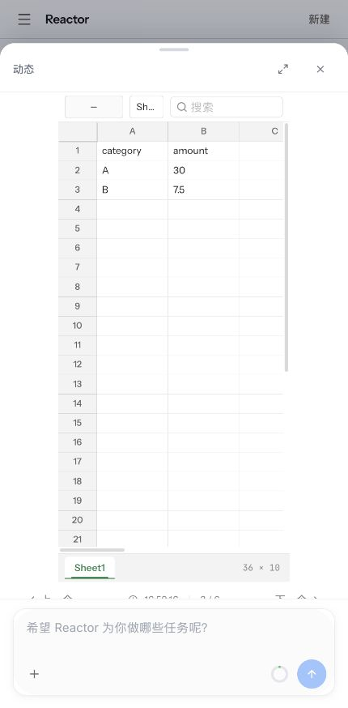

# P3 前轮研究、RAG、问数与沙箱迁移记录（历史）

> 当前P3收尾已完成，SQLite/私有ACL已按最新授权实现；以下待确认和旧测试数字属于前轮历史。最终结果、失败处置及P4入口以 [P3收尾报告](p3-closure-report.md) 和 [progress](progress.md) 为准。

2026-10-03，Asia/Shanghai。用户授权 P3，止于 P3；本轮在原 P2 上增量实施，原 Java、UI 与默认部署保留。origin 仍为原作者仓库，无 push/PR/remote 修改；不加载 .env、不连接已有数据源、不执行 DROP。

## M1 工具/流/账本

- `adapters/research_tools.py` 复用原 Tool DeepSearch/CodeAct/auto_analysis/MRAG/social；`tool_stream.py` 单独解码 Tool SSE，不把 `[DONE]` 投影为主 Agent 结束。
- `research/results.py` 累积并去重来源 URL、章节、完整报告；完整检索结果/报告经原文件 API 写入。原始未知字段保存在 Tool 事件阶段，持久化不截断。
- `adapters/web_search.py` 迁移原 Java 五个原生渠道（Grok→GPT→Exa→Tavily→Brave），域名限制、失败回退和来源；DDG/Bing/Jina/Sogou/Serper/Exa 的 DeepSearch 引擎继续原 Tool 实现。Skill/MCP 渠道属于 P4，不能称全部原生内置。
- `adapters/web_fetch.py` 保留 Java HTTPS升级/同host redirect/二次模型提炼和显式降级；正文解析及完整文件仍由原 Tool 承担。
- `adapters/tool_outputs.py` 在 invocation 完成同事务写入现有 deep_search/code_interpreter/data_analysis/multimodal_agent 专用表；原历史 projector 继续读相同字段和 ID。
- 59 项 P1/P2 确定性回归通过；新增 26 项 P3 工具/SQL隔离测试通过。TCP、旧 Java、UI 和外部验证在后续 M2/M3 检查点记录。

## M2 问数

`data_query/service.py`、`data_query/sql.py`、`adapters/data_catalog.py`、`adapters/business_db.py`、`transport/data.py` 提供所有原 `/data` 入口。schema 从原 MySQL 元数据去重读取；可选 TableRAG 召回、一次重试、显式记录原全量schema回退及默认字段补集；原 Tool NL2SQL生成→SQL AST解析与模型关系替换→独立业务 DB实际 SELECT→原表格/图表 DTO→CSV、图表配置、来源清单文件。原 ChatDataMessage SSE 保持 DEBUG/THINK/finished_stream/CHART_DATA/ERROR/READY，与主Agent流分开。

新增 sqlglot 只负责原 Java SQL parser 的职责，不新增 RAG/代码执行器。业务 MySQL 和 ClickHouse 使用显式独立连接，不复用 Reactor账本。H2原能力保留；是否采用可选 JDBC 过渡 adapter 已提出具体确认，未确认前不启用、不换SQLite，不声称无JVM完成。

## 新发现与确认门

- 原 Tool `CODE_INTERPRETER_ENABLE_PRE_EXECUTION_VALIDATION` / `CODE_INTERPRETER_ENABLE_RUNTIME_DOUBLE_CHECK` 默认 false。隔离负例复现 `/etc/passwd` 可读；P3测试启动明确开启既有守卫。必须开启守卫才能进行安全验收，不能把类存在写成保护已开启。
- 原 CodeAct 与锁定 smolagents=1.19.0 绑定；错误使用1.24.0时 `grammar` 参数导致启动失败，已对齐原锁版本；保留初次日志。
- 原文件/KB服务没有creator/ACL。按P0 A2提出保留URL/JSON、跨访客403、旧无owner拒绝首次认领、独立内部token与受保护代理/加法ACL迁移方案。该外部拒绝/连接调整确认尚未收到；不因缺口阻止无依赖实现，不自动切正式入口。

## 初次失败（保留）

1. 受限环境MySQL初始化SIGSEGV，临时root `reactor-p3-hjwu5tf3`；允许隔离脚本后初始化成功。
2. `reactor-p3-n9wuxskb`：测试文件尚未写完，pytest未运行；已修正执行顺序。
3. `reactor-p3-i_iajlid`：29通过/4失败。模型fixture缺少tool delta index、NL2SQL fixture请求识别和字段返回错误；smolagents版本不符；默认未开守卫。后续修复分别记录复跑结果，不掩盖失败。

原 Tool 全选定测试命令：`reactor-backend/.venv/bin/python reactor-backend/tests/run_tool_tests.py`。每个文件使用新的临时子目录、清理过的env、禁止.env读取和非loopback socket。Mac上的Windows路径假设、E2B fake `/home/user`路径、MRAG旧测试错误帧/路径假设及缺依赖另列，不能将其直接算迁移通过。

## M3 最终已验证范围与真实流程

backend确定性测试101通过（59旧回归、38 P3 adapter/SQL、4新增既有守卫接线），JUnit位于 target/python-migration-p3/unit.xml。集成36通过：原P1/P2 25项加11项P3，全部使用新建Unix-socket MySQL datadir、独立business DB、原SQLite/文件和原Tool路由。旧Java读实际Python写入账本5+2+11帧完全对照；原Java SQL parser/service生成3组真实column/filter DTO，Python对应值完全对照，样本 fixtures/p3-sql-java.json。

- 完整NL2SQL：原NL2SQLAgent用测试模型生成SQL；新建sales实际3行A=10/A=20/B=7.5，MySQL执行汇总A=30/B=7.5。CSV、ECharts配置JSON、query-provenance经原file API落盘并逐个下载/sha256；p3-nl2sql-evidence.json含每个原SSE frame与数据DTO。
- 真实CodeAct：原CIAgent生成代码，原local executor执行、输出37.5、codeact-sales.csv及报告；专用输出表、artifact/session/run/tool ID和历史实测。stdout缺失与smolagents版本问题修复后通过。
- 自动分析：dataAgent模式只开放原data_analysis；原auto_analysis FC Agent→内层get_data→新Python /data/apiChatQuery→原NL2SQLAgent→业务MySQL→真实DataFrame Markdown→完整报告与专用账本。测试模型只生成工具代码，数值由SQL返回；p3-analysis-evidence.json含完整事件/文件。
- 公开WebFetch：原Tool抓取 https://docs.python.org/3/tutorial/index.html ，完整The_Python_Tutorial.md下载证据SHA256为 f6e1402475c8feab0c3b594d08ecedd216860edf73c2ce17c8a2c5115d3c1928。原fileSize与preview字节数不同，保留原事实，不伪造一致；真实供应商提炼U。
- 原React：命名→P3_LOCAL→真实sales.csv预览A=30/B=7.5；刷新→侧栏恢复相同工具/文件，截图p3-ui-code.png/p3-ui-refresh.png。MRAG→知识源→新建“P3来源证据库”，原SQLite写入并显示ID，截图p3-ui-kb.png。/workspace/sop实际保存明确缺Qdrant，截图p3-ui-sop-error.png。初次MRAG Failed to fetch系test host未带原server CORS，补为原配置后成功；原UI未改。

样本复制到 [fixtures/p3-artifacts](fixtures/p3-artifacts)，隔离进程停止后仍可查看。[机器清单](fixtures/p3-evidence.json)保留原路径、大小与SHA256；临时root保留日志/JUnit，不自动清库。

## 类存在、配置启用、渠道实测

| 渠道/外部服务 | 实现存在 | 本轮启用 | 独立状态 |
|---|---|---|---|
| WebSearch Grok | Java native Python HTTP | 无key | 请求/fallback fixture V；live U |
| WebSearch GPT/Responses | Java native Python HTTP | 无key | 请求/URL引用 fixture V；live U |
| WebSearch Exa | Java native Python HTTP | 无key | 请求/域限制 fixture V；live U |
| WebSearch Tavily | Java native Python HTTP | 无key | 请求 fixture V；live U |
| WebSearch Brave | Java native Python GET | 无key | 请求 fixture V；live U |
| DeepSearch DDG | 原DDGSearch | 原默认ddg | engine/config测试V；网络完整研究live U |
| DeepSearch Bing | 原BingSearch | 未选 | 开关测试；live U |
| DeepSearch Jina | 原JinaSearch | 未选/无key | 原direct/Jina fallback隔离测试；Jina live U |
| DeepSearch Sogou | 原SogouSearch | 未选 | 原继承实现保留；live U |
| DeepSearch Serper（serp） | 原SerperSearch | 未选/无key | 原实现保留；live U |
| DeepSearch Exa | 原ExaSearch | 未选/无key | 原实现保留；live U |
| WebFetch direct HTTP | 原WebFetcher+Python处理 | 公开Python教程 | 完整正文文件实际V；提炼fixture |
| Twitter | 原只读Tool | 无平台凭证 | 真实AUTH_REQUIRED失败V；live U |
| Reddit | 原只读Tool | 无平台凭证 | 真实缺凭证失败V；live U |
| 雪球 | 原只读Tool | 无平台凭证 | 真实缺凭证失败V；live U |
| MRAG SQLite KB/doc/session/turn | 原stores/routes | 新临时SQLite | 建库/历史CRUD及原文档测试V |
| MRAG Qdrant | 原VectorStore/query | 未配server | 实际检索/入库/删除U；本机Docker engine不可达，未操作已有容器 |
| text/image/page embedding | 原共享代理 | 测试dim=3，无真实模型 | schema vector协议fixture；live U |
| MRAG VLM/rerank | 原MRAG agent | 无凭证 | stream/error与原query测试；live U |
| MRAG MinerU/OCR | 原parser/OCR桥接 | 无实际服务 | PDF/图片入库→引用全链路U |
| MRAG URL/crawl4ai/OSS | 原URL/document adapters | 临时crawl-cache，无OSS凭证 | 文档routes隔离测试V；URL向量/OSS live U |
| SOP Qdrant/embedding/rerank | 原workspace/PlanSOP | 未配服务 | 原CRUD mock+recall测试V；TCP/UI明确失败，完整live U |
| TableRAG ES | 原Tool+PythonES recall | 测试关闭 | fallback/default schema/启用协议fixture V；真实ES U |
| TableRAG Qdrant | 原Tool+Pythonvector recall | 测试关闭 | 启用协议fixture V；真实Qdrant U |
| MySQL账本/业务MySQL | 原表+真实adapter | 两个新独立库 | SQL/analysis/preview实际V；旧数据副本U |
| ClickHouse | 真实HTTP SQL adapter | 未配实例 | SQL/FORMAT JSON fixture V；实际方言DB U |
| H2 | 原Java mem/JDBC实际路径 | Python未启用 | P0原mem V；部署/可选桥接待确认，不称无JVM完成 |
| local CodeAct/code_execution | 原CIAgent/Executor | local+三个guard=true | 执行/文件/语法/超时/越界拒绝V |
| E2B | 原SDK/backend与API | 未选/无key | config V，Mac fake 5失败；真实remote U |
| Skill/MCP研究渠道 | 原类/资源渠道 | 完整runtime留P4 | 不能称全部原生内置；本轮未跨阶段接入 |

## 原Tool测试未全绿

run_tool_tests.py选定24原文件共127测试：114通过/13失败/0error，不跳过失败。root为reactor-p3-tool-tests-yzgfw6ub；完整日志/JUnit见target/python-migration-p3/tool-tests.json。

- permissions 5失败：Windows D:\temp路径在Mac语义不同。
- runtime_guard 1失败：旧用例预期analysis相对写入output，当前原policy统一workspace；保留失败，不改目录协议。
- E2B 5失败：原fake在Mac执行Linux /home/user引导；没有live E2B，不创建该主机路径。
- MRAG API 1失败：旧用例预期异常首帧choices，原实现首帧stage=error；Python正确拒绝stageerror，未改原protocol。
- MRAG document parser 1失败：Mac /var与realpath /private/var字符串差异，实际文件相同。

scipy/tabulate/crawl4ai依赖采集错误已按原版本补齐；CRAWL4_AI_BASE_DIRECTORY指向临时root，不创建用户HOME缓存。requests/chardet兼容warning和matplotlib/pyparsing deprecation保留。

## 已批准修复、失败复跑与剩余门

用户两次具体批准，仅补原三个Tool文件：executor透传3既有guard开关；runner调用原静态校验；runtime guard给builtins.open/io.open复用原路径校验。实际跨工作区拒绝、正常CSV/CodeAct成功。语言I/O守卫不等同OS/container全面安全边界。Tool API/Sandbox仍须显式三个开关全部开启；未改.env。

保留后续失败：52m2g3rx为31/2（filelist旧断言/guard）；iu3fqi6b为32/1（guard）；tp75ppk4为33/2（open未接/SOP被错误假设为SQLite）；6d0bmabh为import readiness超时（本地成本表/60秒readiness修复）；c6g1dl9_为34/1（time import被静态权限拒绝，改真实busy-loop超时）；muuyctqh为35/1（macOS系统代理影响loopback callbacks，隔离NO_PROXY修复）；随后eldwfzcr为36通过及Java回放；最终5bcl0tfu再次36通过（24.90s），Java5+2+11帧通过。最终root见机器清单。

P0 A2私有Tool file/KB/data query可信owner/gateway、403和加法映射尚未获具体批准；H2 mem可选JDBC过渡也未确认。[具体方案](p3-pending-decisions.md)供审阅，不重新请求P2已批准owner/恢复。**本轮实现与隔离验证交付，P3正式启用/全量验收不能标完成；不开始P4/P5。** 缺凭证服务保留真实调用路径，各项live U。

## 可复现命令与停止点

启动/显式配置/测试和原UI连接见 [backend README](../../reactor-backend/README.md)。uv lock --check --offline及Git diff check通过；无push/PR/remote更改、DROP/生产操作/.env覆盖。workflow SHA256仍为 f1eca5939f829e26e6ea45c66a07c92d8bb9536d16a8fffb33b23bbbe667248e；原.gitignore改动保持。

下一入口先关闭上述P3确认门及所需外部验收，之后才是plan P4，需新授权。原Java/default保留回滚；停止Python owner后使用原入口，不双写session。

原工作台真实CSV预览（原UI，隔离SQL/Tool执行）：

收尾确认：本轮创建的backend/原Tool/模型fixture/新MySQL/Vite和测试标签均已停止；日志与新建数据目录保留。文档本地链接、11个复制样本SHA256、uv离线锁和Git diff检查通过。
